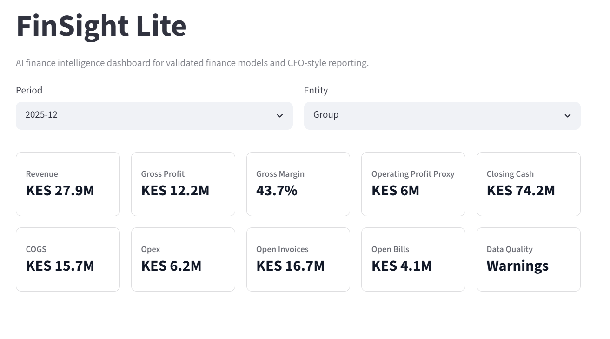
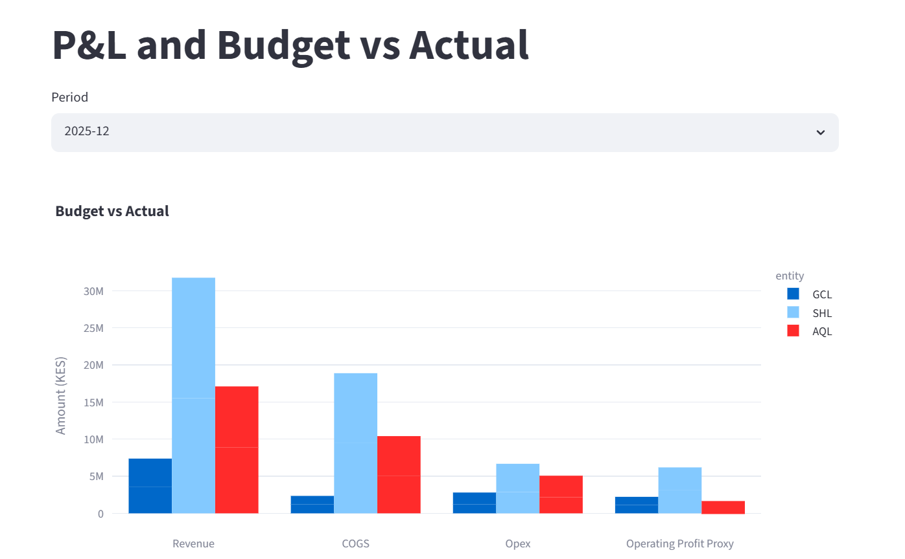
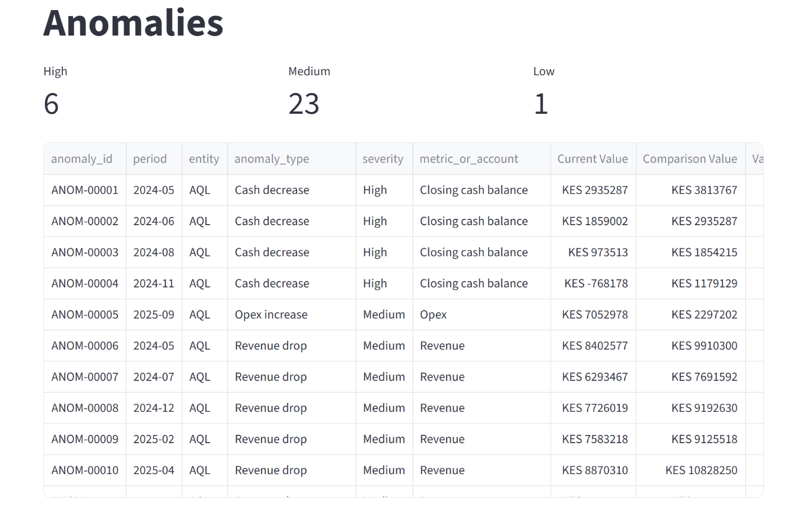
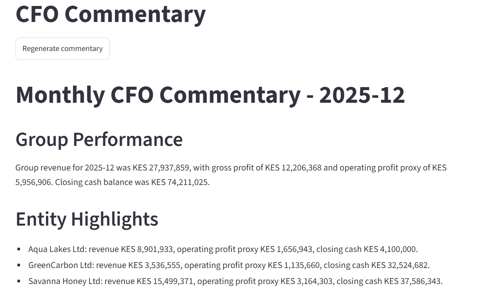
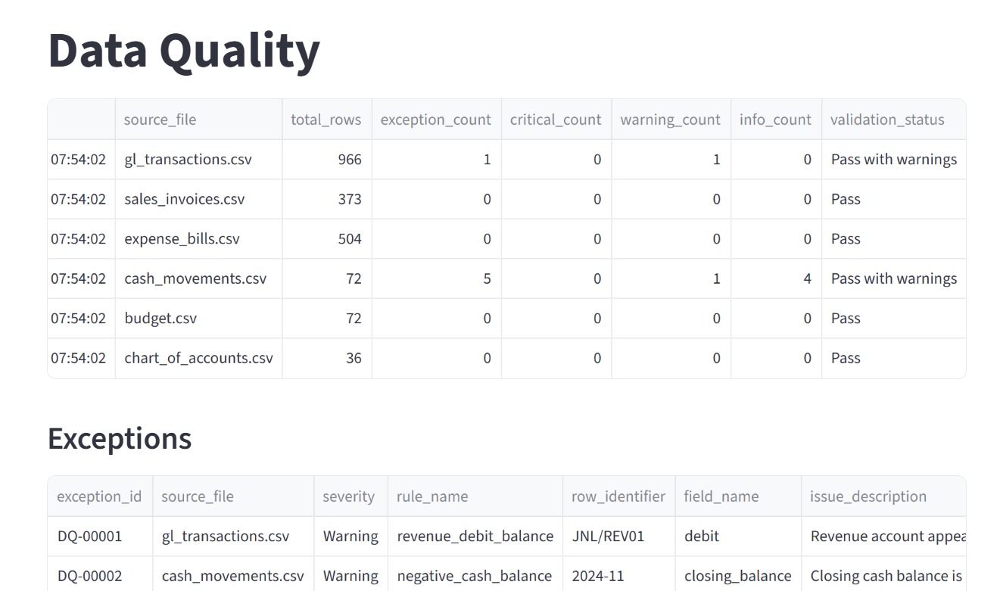

# Fin.AI — AI-Powered Finance Intelligence Platform

**Transforming raw financial data into trusted insights through data engineering, automated controls, anomaly detection, and AI-assisted financial analysis.**

Fin.AI is an end-to-end finance intelligence platform designed to help finance teams convert unstructured ERP and accounting exports into validated financial models, actionable business insights, and executive-level reporting.

Built using **Python, DuckDB, dbt, Streamlit, and Plotly**, the platform integrates financial data processing, automated validation, anomaly detection, and AI-assisted CFO commentary into a unified analytics workflow.

The central design principle behind Fin.AI is **Trust Before Intelligence** — financial insights are generated only after source data has passed validation and financial modelling.

## 1. The Problem

Financial teams frequently work with exports from multiple accounting and ERP systems. These datasets often contain inconsistent account mappings, missing records, reconciliation errors, and unexpected financial movements.

Generating management reports from such data involves several challenges:

- Inconsistent financial records across multiple entities.
- Manual reconciliation and data validation.
- Limited visibility into unusual transactions.
- Time-consuming financial reporting and KPI analysis.
- Risk of generating misleading insights from unreliable data.

Traditional dashboards display financial metrics, while generic AI chat interfaces may interpret raw numbers without understanding the underlying financial controls.

Fin.AI addresses this gap by combining data reliability, financial modelling, and AI-assisted analysis into one controlled pipeline.

## 2. Solution Overview

Fin.AI implements a structured finance analytics workflow:

1. Ingests realistic multi-entity financial datasets.
2. Validates incoming records using financial and data quality rules.
3. Stores raw and validated data in DuckDB.
4. Transforms financial records into reporting models using dbt.
5. Detects unusual financial patterns through explainable anomaly rules.
6. Presents financial KPIs and exceptions through an interactive dashboard.
7. Generates CFO-style commentary using validated financial outputs.

This approach ensures that AI-generated explanations are based on governed financial metrics rather than uncontrolled source data.

## 3. System Architecture

```text
       ERP / Accounting Exports
                  |
                  v
          Financial CSV Ingestion
                  |
                  v
          Data Validation Engine
                  |
          +-------+-------+
          |               |
          v               v
     Valid Records    DQ Exceptions
          |
          v
      DuckDB Database
          |
          v
       dbt Staging
          |
          v
      Finance Marts
          |
     +----+-----------+
     |                |
     v                v
Anomaly Detection  KPI Aggregation
     |                |
     +-------+--------+
             |
             v
      Streamlit Dashboard
             |
             v
      CFO Commentary Engine
             |
             v
      Executive Finance Insights
```

**Architecture principle:** The intelligence layer operates downstream of validation, transformation, and financial controls.

## 4. MVP Implementation & Verified Results

The initial MVP has been successfully executed and verified locally.

| Metric | Verified Result |
|---|---:|
| General Ledger Transactions Processed | 966 |
| Monthly P&L Records Generated | 72 |
| Data Quality Exceptions Identified | 6 |
| Financial Anomalies Generated | 30 |
| dbt Models Executed Successfully | 15 |
| dbt Tests Passed | 4 |
| Pytest Cases Passed | 3 |
| Streamlit Dashboard | HTTP 200 |

These results demonstrate an operational end-to-end workflow, from raw financial data ingestion to validated reporting and executive commentary.

## 5. Core Features

### A. Financial Data Ingestion

Supports multiple finance-related datasets to simulate a multi-entity accounting environment.

- General Ledger transactions.
- Sales invoices.
- Expense bills.
- Cash movements.
- Budget records.
- Chart of Accounts.

### B. Data Validation & Financial Controls

Implements validation rules to identify inconsistencies before financial reporting.

Validation includes:

- Account-code mapping verification.
- Required field validation.
- Transaction date checks.
- Debit and credit consistency.
- Amount reconciliation.
- Invoice and bill status validation.
- Cash movement reconciliation.
- Budget completeness checks.
- Entity-level consistency.

Validation results are maintained in dedicated exception and summary outputs.

```text
outputs/
└── dq/
    ├── dq_exceptions.csv
    └── dq_summary.csv
```

### C. Finance Data Modelling with dbt

Uses a layered dbt architecture to convert transactional accounting data into structured finance models.

The reporting layer covers:

- Monthly Profit & Loss.
- Budget vs Actual.
- Cash Flow and Cash Movement.
- Revenue and Expense Analysis.
- Vendor Analytics.
- Invoice Analysis.
- Financial KPI Summary.

DuckDB acts as the analytical database, while dbt handles transformations and reporting model generation.

### D. Explainable Financial Anomaly Detection

Implements rule-based anomaly detection to identify unusual financial behaviour.

Examples include:

- Unexpected revenue declines.
- Budget overspending.
- Unusually large transactions.
- Abnormal cash movements.
- Other financial KPI deviations.

Each anomaly is generated from structured financial data, making the results easier to investigate and review.

### E. Executive Finance Dashboard

Developed using Streamlit and Plotly, the dashboard provides an interactive interface for analysing financial performance.

Key capabilities include:

- Executive financial overview.
- Monthly P&L analysis.
- Budget vs Actual comparisons.
- Revenue and expense trends.
- Cash movement analysis.
- Financial anomaly investigation.
- Data quality monitoring.

### F. AI-Assisted CFO Commentary

Fin.AI includes a commentary engine that converts structured financial outputs into management-friendly explanations.

The commentary module uses:

- KPI summaries.
- Budget vs Actual performance.
- Cash movement analysis.
- Financial anomaly records.
- Data quality summaries.

The system supports deterministic template-based commentary without requiring paid API access.

When an AI API is configured, the architecture can support AI-assisted commentary while maintaining the same controlled input boundary.

**Important:** The commentary layer is designed to explain existing financial metrics rather than invent financial figures.

## 6. Technology Stack

| Component | Technology |
|---|---|
| Programming Language | Python |
| Data Manipulation | Pandas |
| Analytical Database | DuckDB |
| Transformation Framework | dbt Core |
| dbt Adapter | dbt-duckdb |
| Dashboard Framework | Streamlit |
| Data Visualization | Plotly |
| Testing | Pytest |
| Code Quality | Ruff, Black |
| Data Generation | Synthetic Finance Datasets |

## 7. Project Structure

```text
Fin.AI/
│
├── app/
│   ├── streamlit_app.py
│   └── pages/
│
├── data/
│   ├── sample/
│   └── processed/
│
├── dbt_finance/
│   ├── models/
│   │   ├── staging/
│   │   └── marts/
│   ├── tests/
│   ├── dbt_project.yml
│   └── profiles.yml
│
├── outputs/
│   ├── dq/
│   ├── screenshots/
│   ├── board_summary/
│   └── anomalies.csv
│
├── src/
│   └── finsight/
│       ├── validate.py
│       ├── load_duckdb.py
│       ├── anomalies.py
│       └── commentary.py
│
├── tests/
├── requirements.txt
└── README.md
```

## 8. Running the Project Locally

### Prerequisites

- Python 3.10+
- dbt Core
- dbt-duckdb
- Make (optional on Windows)

### Step 1: Clone the Repository

```bash
git clone <your-repository-url>
cd Fin.AI
```

### Step 2: Create a Virtual Environment

```powershell
python -m venv .venv
.\.venv\Scripts\Activate.ps1
```

### Step 3: Install Dependencies

```bash
pip install -r requirements.txt
```

### Step 4: Execute the Complete Pipeline

```bash
make all
```

This executes the core workflow:

1. Financial data validation.
2. DuckDB data loading.
3. dbt transformations.
4. Financial anomaly generation.
5. CFO commentary generation.

### Step 5: Launch the Dashboard

```bash
streamlit run app/streamlit_app.py
```

### Alternative: Execute Individual Pipeline Components

For Windows environments without Make:

```powershell
python -c "import sys; sys.path.insert(0, 'src'); from finsight.validate import main; main()"

python -c "import sys; sys.path.insert(0, 'src'); from finsight.load_duckdb import main; main()"

cd dbt_finance
dbt run --profiles-dir .
dbt test --profiles-dir .
cd ..

python -c "import sys; sys.path.insert(0, 'src'); from finsight.anomalies import main; main()"

python -c "import sys; sys.path.insert(0, 'src'); from finsight.commentary import main; main()"

streamlit run app/streamlit_app.py
```

## 9. Screenshots & Dashboard Preview

### Executive Overview



### Profit & Loss and Budget Analysis



### Financial Anomaly Detection



### CFO Commentary



### Data Quality Monitoring



## 10. Testing & Verification

The project includes automated checks to verify transformation logic and core functionality.

```bash
cd dbt_finance
dbt run --profiles-dir .
dbt test --profiles-dir .

cd ..
pytest

ruff check app src tests
```

Key generated outputs:

```text
data/processed/finsight.duckdb

outputs/dq/dq_exceptions.csv
outputs/dq/dq_summary.csv

outputs/anomalies.csv

outputs/board_summary/monthly_cfo_commentary.md
outputs/board_summary/monthly_cfo_commentary.txt
```

## 11. Engineering Highlights

Fin.AI demonstrates several practical engineering concepts:

- **Analytics Engineering:** Building structured financial marts using dbt and SQL.
- **Data Reliability:** Implementing validation rules and exception reporting.
- **Financial Modelling:** Converting accounting transactions into management reporting metrics.
- **Anomaly Detection:** Identifying unusual financial patterns through explainable rules.
- **AI Integration:** Generating contextual finance commentary from controlled outputs.
- **Testing & Maintainability:** Using Pytest, dbt tests, Ruff, and Black.
- **End-to-End Pipeline Design:** Connecting ingestion, transformation, analytics, and presentation layers.

## 12. Current Limitations

Fin.AI is currently implemented as a local-first MVP.

The current version does not include:

- Live ERP integrations.
- User authentication and role-based access.
- Multi-user SaaS infrastructure.
- Complex financial forecasting.
- Production deployment infrastructure.
- Automated multi-currency revaluation.

## 13. Future Roadmap

### Finance Data Integrations
- Odoo integration.
- Xero and QuickBooks Online connectors.
- Multi-currency conversion and revaluation.

### Advanced Financial Analytics
- Automated board report generation.
- Audit evidence pack generation.
- Intercompany reconciliation.
- Accounts Receivable and Accounts Payable ageing.
- Inventory and Cost of Goods Sold analytics.
- Payroll variance analysis.

### AI & Agentic Finance Workflows
- RAG over finance policies and standard operating procedures.
- AI-assisted financial close checklists.
- Agent-based investigation of financial anomalies.
- Human approval workflows for sensitive financial actions.

### Production Engineering
- Cloud deployment.
- Authentication and role-based access control.
- Scalable data ingestion.
- Audit logging and monitoring.

## 14. Project Summary

Fin.AI is an AI-powered finance intelligence platform that transforms ERP-style accounting exports into validated financial models, actionable KPIs, and executive-level insights. By combining DuckDB, dbt, automated data quality controls, explainable anomaly detection, and AI-assisted CFO commentary, it demonstrates how reliable financial analytics can be built around a control-first architecture.

---

## Author

**Kosuru Varshit**

B.Tech, Electrical Engineering  
Indian Institute of Technology Bhubaneswar

[GitHub](https://github.com/Varshitcode14)
